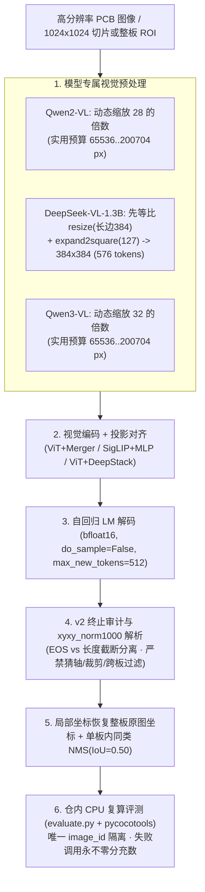

# Open-Source VLM Architectures & FICS-PCB Evaluation Protocol

本文档基于仓库源码与实际部署模型快照的本地配置，梳理本项目中实际参与评测的三款开源视觉-语言模型（`Qwen2-VL-2B-Instruct`、`deepseek-vl-1.3b-chat`、`Qwen3-VL-2B-Instruct`）的端到端架构机制、图像到坐标预测通路、外部任务契约与跨模型比较混杂因素。

> **口径声明**：本项目的三模型对比在固定外部任务提示（`xyxy_norm1000` JSON 数组）、6 类目标语义与 `512` token 生成上限下进行，各模型在预训练目标、视觉分辨率策略与软件依赖上存在联合差异，属于**联合配置对照**而非严格单变量消融。**三者均通过自回归语言模型生成文本坐标，本项目未验证也不主张其中任何模型具备独立于 LM 的专门视觉检测头（detection head）。**

---

## 一、三模型核心架构与本地部署证据对照

以下参数均逐项核对自本地权重目录 `config.json`、`preprocessor_config.json`、`tokenizer_config.json`、`generation_config.json` 及仓内适配器/底层代码（`src/pcb_vlm/models/`、`src/deepseek_vl/`）。

| 维度 | `Qwen/Qwen2-VL-2B-Instruct` | `deepseek-ai/deepseek-vl-1.3b-chat`（v1 `1.3B`） | `Qwen/Qwen3-VL-2B-Instruct` |
|---|---|---|---|
| **官方资料与权重页** | [arXiv:2409.12191](https://arxiv.org/abs/2409.12191) · [HF Hub](https://huggingface.co/Qwen/Qwen2-VL-2B-Instruct) | [arXiv:2403.05525](https://arxiv.org/abs/2403.05525) · [GitHub: DeepSeek-VL](https://github.com/deepseek-ai/DeepSeek-VL) · [HF Hub](https://huggingface.co/deepseek-ai/deepseek-vl-1.3b-chat) | [arXiv:2511.21631](https://arxiv.org/abs/2511.21631) · [GitHub: Qwen3-VL](https://github.com/QwenLM/Qwen3-VL) · [HF Hub](https://huggingface.co/Qwen/Qwen3-VL-2B-Instruct) |
| **模型类 / `model_type`** | `Qwen2VLForConditionalGeneration` / `qwen2_vl` | `MultiModalityCausalLM` / `multi_modality` | `Qwen3VLForConditionalGeneration` / `qwen3_vl` |
| **本地 `config.json` 保存版本（静态配置字段）** | `4.41.2`（权重配置文件写入字段，非实跑环境版本） | `4.38.2`（权重配置文件写入字段，非实跑环境版本） | `4.57.0.dev0`（权重配置文件写入字段，非实跑环境版本） |
| **正式运行日志实测环境版本（`session_summary.json` `worker_load_meta`）** | `transformers 4.46.3` / `torch 2.5.1+cu121`（基础环境） | `transformers 4.46.3` / `torch 2.5.1+cu121`（仓内 `src/deepseek_vl/` + 基础环境） | `transformers 4.57.6` / `torch 2.5.1+cu121`（隔离 `dependency-overlay`） |
| **视觉编码器（Vision Encoder）** | 32 层 ViT（`embed_dim=1280`, `num_heads=16`, `patch_size=14`, `temporal_patch_size=2`） | **单路** `CLIPVisionTower`：`siglip_large_patch16_384`（`image_size=384`, `select_layer=-1`, `select_feature="same"`；区别于 7B 的 SigLIP+SAM-B 混合塔） | 24 层 ViT（`hidden_size=1024`, `intermediate_size=4096`, `num_heads=16`, `patch_size=16`, `temporal_patch_size=2`, `gelu_pytorch_tanh`） |
| **跨模态连接器（Connector / Merger）** | `PatchMerger` 2×2 空间合并（`spatial_merge_size=2`），映射至 `hidden_size=1536` | `MlpProjector`（2 层 `mlp_gelu`，`1024 → 2048`），通过 `<image_placeholder>` 插入文本嵌入序列 | 2×2 空间合并（`spatial_merge_size=2`, `out_hidden_size=2048`）+ **DeepStack** 多层视觉特征注入（`deepstack_visual_indexes=[5, 11, 17]`） |
| **语言模型骨干（LLM Backbone）** | Qwen2（28 层, `hidden_size=1536`, `intermediate_size=8960`, 12 Q / 2 KV 头 GQA, `silu`, `vocab_size=151936`, `max_pos=32768`） | LLaMA 架构（24 层, `hidden_size=2048`, `intermediate_size=5632`, 16 Q / 16 KV 头 MHA, `vocab_size=102400`；本地 `config.json` 写 `max_position_embeddings=16384`，官方 DeepSeek-VL README 发布上下文长度为 **`4096`**） | `qwen3_vl_text`（28 层, `hidden_size=2048`, `intermediate_size=6144`, 16 Q / 8 KV 头 GQA, `head_dim=128`, `vocab_size=151936`, `max_pos=262144`） |
| **位置编码（Positional Embedding）** | 3D **MRoPE**（`mrope_section=[16, 24, 24]`, `rope_theta=1e6`） | 标准 **1D RoPE**（LLaMA `LlamaForCausalLM`，视觉 patch 按 1D 序列嵌入） | **Interleaved-MRoPE**（`mrope_interleaved=true`, `mrope_section=[24, 20, 20]`, `rope_theta=5e6`） |
| **图像预处理与视觉 Token 形成** | `Qwen2VLImageProcessor` 动态分辨率；最小块 `28×28` 像素（`patch=14 × merge=2`）= 1 视觉 token；实用实验约束 `min_pixels=65536, max_pixels=200704` | `VLMImageProcessor`（`src/deepseek_vl/models/image_processing_vlm.py:137-156`）先保持纵横比将长边等比 `resize` 到 **`384`**（短边下限 `14`），再用 `expand2square` 灰度 `[127,127,127]` 补齐为 **`384×384`**，恒定产生 **`576` 视觉 token**（`(384/16)^2`）；**`max_pixels` 不生效** | `Qwen2VLImageProcessorFast` 动态分辨率；最小块 `32×32` 像素（`patch=16 × merge=2`）= 1 视觉 token；实用实验约束 `shortest_edge=65536, longest_edge=200704` |
| **对话模板与终止 Token（EOS）** | `<\|im_start\|>` / `<\|im_end\|>`；`eos_token_id=[151645, 151643]` | `VLChatProcessor`（`sft_format="deepseek"`）；`eos_token_id=[100001]`（`<｜end▁of▁sentence｜>`） | `<\|im_start\|>` / `<\|im_end\|>`；`eos_token_id=[151645, 151643]` |
| **官方定位协议声明 vs 本项目契约** | 官方资料支持基于 `[0,1000]` 范围的坐标定位表达式；**本项目统一约束为纯 JSON `xyxy_norm1000` 文本契约** | 官方 DeepSeek-VL v1 仓库未声明类似 DeepSeek-VL2（`<\|ref\|>/<\|det\|>`）或 Qwen 的专门坐标定位格式协议；在本项目固定纯 JSON `xyxy_norm1000` 契约下未稳定遵循 JSON 输出（58/67 正常 EOS 格式不合规，64 GT 上 0 TP）；不采用 VL2 专用语法 | 官方资料支持跨模态坐标定位输出；**本项目统一约束为纯 JSON `xyxy_norm1000` 文本契约** |
| **权重生成默认与本次统一覆盖** | 本地 `generation_config.json` 默认含 `do_sample=true, temperature=0.01`；**正式实验统一覆盖为确定性解码 `do_sample=false, max_new_tokens=512`** | 无独立采样 `generation_config` 覆盖；正式实验统一 `do_sample=false, max_new_tokens=512` | 本地 `generation_config.json` 默认 `do_sample=true, temperature=0.7, top_p=0.8`；**正式实验统一覆盖为 `do_sample=false, max_new_tokens=512`** |

---

## 二、图像到检测框端到端推理与评测链路

### 关键实现机理说明

1. **视觉 token 序列注入**：
   - `Qwen2-VL` 与 `Qwen3-VL` 在动态网格划分后使用 2×2 `PatchMerger` 压缩空间 token 数，并以 3D（时间/高/宽）MRoPE / Interleaved-MRoPE 为每个视觉 token 编码精确二维网格位置，使语言层能直接感知局部相对空间位置。其中 `Qwen3-VL` 还通过 `deepstack_visual_indexes=[5, 11, 17]` 将多层 ViT 浅中深特征同步注入解码器前端。
   - `deepseek-vl-1.3b-chat` 在 `MultiModalityCausalLM.prepare_inputs_embeds()`（`src/deepseek_vl/models/modeling_vlm.py:138-177`）中将经过 `resize -> expand2square(384×384)` 的图像经 SigLIP 与 2 层 GELU MLP 映射为固定 576 个向量并直接替换文本序列中的 `<image_placeholder>`，后续 LLaMA 解码层仅见 1D 序列 RoPE。因缺乏直接训练语料细节，本文档不对权重微调配方作负向断言，仅记录：**在本项目固定外部 `xyxy_norm1000` JSON 契约下，该配置于两块开发板 67 次调用中 58 次在正常 EOS 下返回自然语言或不合规输出（仅切片含 6 个误报框，64 GT 上 0 TP）。**
2. **统一外部坐标契约、FICS 配置独立性与公共解析器复用**：
   - 统一提示词（SHA-256 `e46d61e2042c5da503101cf06bd577a7b4ebdaaa7d135b033b27866d6b53aae7`）要求输出 `[{"bbox_2d": [xmin, ymin, xmax, ymax], "label": "<6选1类>"}]`（`[0, 1000]` 归一化，禁止 `yxyx` 猜测、坐标裁剪或倒置交换）。
   - 解析链路复用仓内公共 `coordinate_protocol.parse_response()`（其底层读取 `pcb_vlm.config.get_canonical_categories()` 的全部规范类名）执行几何还原与兼容性提取，随后在 `src/pcb_vlm/evaluation/fics_replay.py` 中严格依据独立配置 `configs/fics_six_classes.yaml` 与 `FICS_CANONICAL_CATEGORIES` 过滤、核对 COCO `categories` 并校验 YAML 6 类与公共允许集合对齐；**FICS 配置保持 6 类独立且不修改或覆盖 WACV 11 类全局默认配置**。
   - 解析器基于 `generated_token_ids` 末尾是否命中模型专属 EOS 区分**真长度截断**（`length_limited_without_eos`：无 EOS 且生成长度 ≥ 512）与**正常 EOS 下的格式/契约不完整**（`syntax_or_format_incomplete_after_eos`），并分别记录 `complete_json_syntax`、`strict_schema_ok`（严格有限数值 JSON 数组，即使恰好在 512 token 边界闭合仍保留结构合法标记）与兼容提取，同时通过 `replay_fics_eval.py` 强制核对冻结计划规格、GT 身份 SHA-256 与输出防覆盖检查。

---

## 三、对比中的主要混杂因素与边界说明

1. **视觉输入有效分辨率差异（非纯语言骨干对比）**：在整板 W 模式（`s18` `3489×1926`、`s28` `8256×3801`）与 T 切片（`1024×1024` / 边缘不足块）上，`Qwen2-VL` 和 `Qwen3-VL` 保持长宽比动态缩放至 `≤200,704 px`（例如 `~448×448`），而 `deepseek-vl-1.3b-chat` 先保持纵横比将长边等比 `resize` 到 `384`，再用 `[127,127,127]` `expand2square` 补齐至 `384×384`。宽幅整板经等比缩至 384 宽并灰边补齐后，有效板面像素占比显著下降，微小元器件更易失真。
2. **输出长度预算与长输出截断偏置**：512-token 生成上限对密集切片可能截断未闭 JSON（三模型分别发生 12 / 8 / 10 次无 EOS 长度截断）；同时历史 Qwen3 高预算探索（1024 token、65536..1310720 px）仅作为独立参考表留存，**不可与实用预算主表混用**。
3. **无校准置信度分数**：所有 VLM 预测均不输出原生连续目标概率，评测统一赋 `score=1.0`，因此核心判据为 `IoU=0.50` 严格一对一匹配的 `TP / FP / FN / P / R / F1`，`COCO AP50 / mAP@[.50:.95]` 仅作为补充参考指标。
4. **软件依赖栈不可合并**：`Qwen3-VL` 本地权重 `config.json` 写入版本为 `4.57.0.dev0`，实际 GPU 会话日志（`worker_load_meta`）测得运行库为隔离 `dependency-overlay` 下的 **`transformers 4.57.6`**（`torch 2.5.1+cu121`）；而 `Qwen2-VL` 与 `DeepSeek-VL`（静态 `config.json` 分别记为 `4.41.2` / `4.38.2`）在基础环境中实际运行版本同为 **`transformers 4.46.3`**（`torch 2.5.1+cu121`）。故 GPU 阶段通过独立子进程分环境顺序运行；CPU 复算与回归测试完全不加载任何模型权重。
